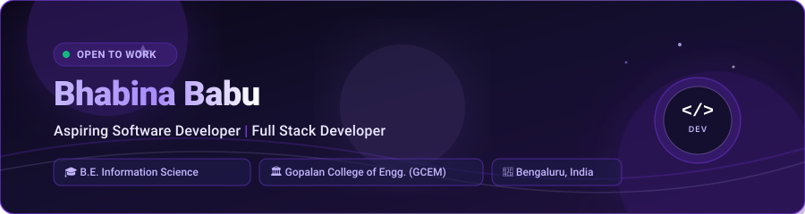

  <!-- Header Banner -->

  

    

  <!-- Status Badges -->

  <a href="https://github.com/Bhabina2005">

    

  </a>

  <a href="https://github.com/Bhabina2005">

    

  </a>

  <a href="https://github.com/Bhabina2005">

    

  </a>

  <a href="https://github.com/Bhabina2005">

    

  </a>

    

  <!-- Animated Typing Introduction -->

  <a href="https://github.com/Bhabina2005">

    

  </a>

  

## 👤 About Me

Hello! I'm **Bhabina Babu**, an Information Science and Engineering student passionate about software development, full stack development and web technologies.

I enjoy building practical applications, exploring emerging technologies, and solving real-world problems through programming. I am continuously improving my technical skills and working on projects that strengthen my development and problem-solving abilities.

I am interested in opportunities where I can learn, collaborate, and contribute to meaningful software development projects.

  

## 🎓 Education

<table>

  <tr>

    <td width="100%">

      <h3>🏛️ Gopalan College of Engineering and Management, Bengaluru</h3>

      
<b>Degree:</b> Bachelor of Engineering (B.E.)

      
<b>Branch:</b> Information Science and Engineering

      
<b>Academic Period:</b> 2023 – 2027

      
<b>Current Status:</b> Final Year Undergraduate

      
<b>Current CGPA:</b> 8.64 / 10

      

        

        

        

        

      

    </td>

  </tr>

</table>

  

## 💼 Internship Experience

<table>

  <tr>

    <td width="100%">

      <h3>🏢 Advanced Engineering Services (AES), Tiruchirappalli</h3>

      
<b>Role:</b> Frontend Development Intern  |  <b>Duration:</b> May 2026 – July 2026

      

        <b>Technologies:</b>

        

        

        

        

      

      <ul>

        <li><b>Management Information System (MIS):</b> Developed and enhanced user-facing modules for an internal enterprise MIS platform designed to streamline operational workflows.</li>

        <li><b>Dashboard & Performance Monitoring:</b> Engineered interactive frontend interfaces for performance metrics, real-time analytics, and status tracking dashboards.</li>

        <li><b>Core Enterprise Modules:</b> Implemented responsive data views, structured input forms, and status logs for key modules including the <b>Proposal Register</b>, <b>Review Sheet</b>, and <b>Purchase Order (PO) Register</b>.</li>

        <li><b>Engineering Collaboration:</b> Maintained clean component architecture, organized state flow, and followed systematic Git branch workflows for seamless team integration.</li>

      </ul>

    </td>

  </tr>

</table>

  

## 🛠️ Technical Skills

  <!-- Skill Icons Strip -->

  

 

<table>

  <tr>

    <th width="30%" align="left">Category</th>

    <th width="70%" align="left">Technologies & Tools</th>

  </tr>

  <tr>

    <td><b>Programming Languages</b></td>

    <td>

      

      

      

    </td>

  </tr>

  <tr>

    <td><b>Frontend Development</b></td>

    <td>

      

      

      

      

      

    </td>

  </tr>

  <tr>

    <td><b>Backend Development</b></td>

    <td>

      

      

    </td>

  </tr>

  <tr>

    <td><b>Databases</b></td>

    <td>

      

      

      

    </td>

  </tr>

  <tr>

    <td><b>Developer Tools</b></td>

    <td>

      

      

      

    </td>

  </tr>

</table>

  

## 🚀 Featured Projects

<table>

  <!-- Project 1 -->

  <tr>

    <td>

      <h3>📊 01. Academic Result Analytics and Prediction System</h3>

      
<i>A comprehensive web-based academic analytics and performance forecasting system designed to streamline institutional evaluation.</i>

      <ul>

        <li><b>Result Processing & Calculation:</b> Implemented automated batch score evaluation, SGPA/CGPA computation, and grade threshold classifications.</li>

        <li><b>Analytics & Ranking:</b> Built subject-wise statistical reports, class rankings, score distribution graphs, and performance trajectory metrics.</li>

        <li><b>Prediction Engine:</b> Analyzes academic trends across semesters to forecast performance outcomes and assist educators in targeted academic support.</li>

      </ul>

      

        <b>Technologies:</b>

        <code>Python</code> • <code>Flask</code> • <code>SQLite</code> • <code>MySQL</code> • <code>JavaScript</code> • <code>HTML5</code> • <code>CSS3</code>

      

      

        

      

    </td>

  </tr>

  <!-- Project 2 -->

  <tr>

    <td>

      <h3>🤖 02. DocuChat AI – Document Question Answering System</h3>

      
<i>An intelligent document question answering platform enabling users to upload documents and retrieve accurate, source-grounded answers.</i>

      <ul>

        <li><b>Hybrid Text & OCR Extraction:</b> Processes structured text documents and scanned image-based pages seamlessly using <code>PyMuPDF</code> and <code>Tesseract OCR</code>.</li>

        <li><b>Source-Grounded Answers:</b> Maps user queries directly to document sections to provide concise answers accompanied by verifiable text passages.</li>

        <li><b>Relational Persistence:</b> Integrates MySQL for user session tracking, document indexing, query history, and metadata management.</li>

      </ul>

      

        <b>Technologies:</b>

        <code>Python</code> • <code>Flask</code> • <code>MySQL</code> • <code>JavaScript</code> • <code>PyMuPDF</code> • <code>Tesseract OCR</code> • <code>HTML5</code> • <code>CSS3</code>

      

      

        

      

    </td>

  </tr>

  <!-- Project 3 -->

  <tr>

    <td>

      <h3>📄 03. PDF Toolkit</h3>

      
<i>A lightweight, high-performance, and privacy-first client-side web application that lets users merge and split PDF documents directly inside the browser.</i>

      <ul>

        <li><b>PDF Merge & Split Utilities:</b> Combine multiple documents into a single document or extract specific page ranges with real-time browser preview.</li>

        <li><b>100% Client-Side Privacy:</b> Uses <code>pdf-lib</code> and browser <code>ArrayBuffer</code> APIs to manipulate files directly in local memory—no documents are uploaded to external servers.</li>

        <li><b>Modern UI/UX:</b> Features a sleek glassmorphic interface, intuitive file drag-and-drop workflow, and responsive layout across mobile and desktop devices.</li>

      </ul>

      

        <b>Technologies:</b>

        <code>HTML5</code> • <code>CSS3</code> • <code>Bootstrap 5</code> • <code>JavaScript (ES6+)</code> • <code>pdf-lib</code>

      

      

        <a href="https://github.com/Bhabina2005/pdf-toolkit">

          

        </a>
         
        <a href="https://bhabina2005.github.io/pdf-toolkit/">

          

        </a>

      

    </td>

  </tr>

  <!-- Project 4 -->

  <tr>

    <td>

      <h3>🪪 04. Student ID Card Generator</h3>

      
<i>A feature-rich, client-side web application developed for Gopalan College of Engineering and Management (GCEM) to automate and manage student identification card issuance.</i>

      <ul>

        <li><b>Dynamic Card Generation:</b> Instantly creates professional student ID cards complete with student credentials and real-time profile picture uploads via the HTML5 <code>FileReader</code> API.</li>

        <li><b>Client-Side Integrity & Persistence:</b> Form validation for USN, phone numbers, and branches, backed by browser-based <code>localStorage</code> to retain records without a dedicated backend server.</li>

        <li><b>Print & Export Capabilities:</b> Includes dedicated print formatting tailored for physical card output and one-click JSON data export for administrative archiving.</li>

      </ul>

      

        <b>Technologies:</b>

        <code>HTML5</code> • <code>CSS3</code> • <code>JavaScript (ES6+)</code> • <code>LocalStorage API</code> • <code>FileReader API</code>

      

      

        <a href="https://github.com/Bhabina2005/MultiStudent-ID-Card-Portal">

          

        </a>
         
        <a href="https://bhabina2005.github.io/MultiStudent-ID-Card-Portal/">

          

        </a>

      

    </td>

  </tr>

</table>

  

## 💡 Additional Projects

<table>

  <!-- Additional Project 1 -->

  <tr>

    <td>

      <h3>🌱 Habinova – Mobile Habit Tracking Application</h3>

      
<i>A feature-rich cross-platform mobile application engineered to assist users in building consistent routines and tracking habit progress.</i>

      <ul>

        <li><b>Structured Routine Builder:</b> Supports customized habit cadences, category grouping, streak tracking, and daily interactive check-ins.</li>

        <li><b>Local Persistence & Scheduling:</b> Built using clean feature-driven architecture backed by <code>Drift</code> (SQLite) with local push notification reminders.</li>

        <li><b>Analytics & Gamification:</b> Provides weekly review summaries, completion rate charts, and achievement badges for habit milestones.</li>

      </ul>

      

        <b>Technologies:</b>

        <code>Flutter</code> • <code>Dart</code> • <code>Drift (SQLite)</code> • <code>Local Notifications</code>

      

      

        

        

      

    </td>

  </tr>

  <!-- Additional Project 2 -->

  <tr>

    <td>

      <h3>🏦 Nexus Bank – Enterprise Banking Management System</h3>

      
<i>A desktop financial management system engineered with ACID-compliant relational persistence and administrative reporting tools.</i>

      <ul>

        <li><b>Core Banking Operations:</b> Implements secure role-based authentication, customer account management, deposits, withdrawals, and balance-protected transfers.</li>

        <li><b>Automated Reporting Engine:</b> Generates professional transaction receipts and analytical audit ledgers in both PDF (ReportLab) and Excel (OpenPyXL) formats.</li>

        <li><b>Modern Desktop UI:</b> Designed with an intuitive dark-mode interface built using CustomTkinter and object-oriented architecture.</li>

      </ul>

      

        <b>Technologies:</b>

        <code>Python</code> • <code>CustomTkinter</code> • <code>SQLite</code> • <code>ReportLab</code> • <code>OpenPyXL</code>

      

      

        <a href="https://github.com/Bhabina2005/Nexus-Bank-System">

          

        </a>

      

    </td>

  </tr>

</table>

  

## 📜 Certifications & Training

<table>

  <tr>

    <th width="35%" align="left">Program / Certification</th>

    <th width="35%" align="left">Issuing Organization</th>

    <th width="30%" align="left">Type & Status</th>

  </tr>

  <tr>

    <td><b>Machine Learning for All</b></td>

    <td>University of London / Coursera</td>

    <td>

      

    </td>

  </tr>

  <tr>

    <td><b>Web Development Training (30 Hours)</b></td>

    <td>Gopalan College of Engineering and Management (GCEM)</td>

    <td>

      

    </td>

  </tr>

  <tr>

    <td><b>AI Tools Workshop</b></td>

    <td>be10x</td>

    <td>

      

    </td>

  </tr>

</table>

  

## 📚 Currently Learning

I am continuously sharpening my development capabilities and expanding my technical foundation across:

* 🐍 **Advanced Python:** Exploring idiomatic patterns, asynchronous paradigms, and clean architectural design.

* ⚛️ **Modern React.js & Frontend Engineering:** Deepening knowledge of state management, custom hooks, and performance optimization.

* ⚙️ **Backend Development:** Building scalable RESTful APIs, request validation, and modular service architectures.

* 🗄️ **SQL & Database Management:** Query optimization, indexing strategies, normalization, and relational integrity.

* 📊 **Data Analytics:** Applying structured data manipulation and exploratory data analysis to practical domains.

  

## 📈 GitHub Statistics

  <!-- Main GitHub Stats Card & Top Languages Card -->

  <a href="https://github.com/Bhabina2005">

    

  </a>
   
  <a href="https://github.com/Bhabina2005">

    

  </a>

    

  <!-- Streak Stats Card -->

  <a href="https://github.com/Bhabina2005">

    

  </a>

  

## 📊 Contribution Activity

  <!-- Profile Details Summary Card -->

  <a href="https://github.com/Bhabina2005">

    

  </a>

    

  <!-- Contribution Grid Snake Animation -->

  <picture>

    <source media="(prefers-color-scheme: dark)" srcset="https://raw.githubusercontent.com/Bhabina2005/Bhabina2005/output/github-contribution-grid-snake-dark.svg">

    <source media="(prefers-color-scheme: light)" srcset="https://raw.githubusercontent.com/Bhabina2005/Bhabina2005/output/github-contribution-grid-snake.svg">

    

  </picture>

  

## 🤝 Connect With Me

  
Feel free to connect for software development discussions, collaborations, or opportunities!

  <a href="https://github.com/Bhabina2005">

    

  </a>
   
  <a href="https://linkedin.com/in/bhabina-babu">

    

  </a>

    

  <table>

    <tr>

      <th align="left">Platform</th>

      <th align="left">Handle / Name</th>

      <th align="left">Direct Profile Link</th>

    </tr>

    <tr>

      <td><b>GitHub</b></td>

      <td><code>@Bhabina2005</code></td>

      <td><a href="https://github.com/Bhabina2005">github.com/Bhabina2005</a></td>

    </tr>

    <tr>

      <td><b>LinkedIn</b></td>

      <td><code>Bhabina Babu</code></td>

      <td><a href="https://linkedin.com/in/bhabina-babu">linkedin.com/in/bhabina-babu</a></td>

    </tr>

  </table>

 

  <!-- Footer Graphic -->

  

